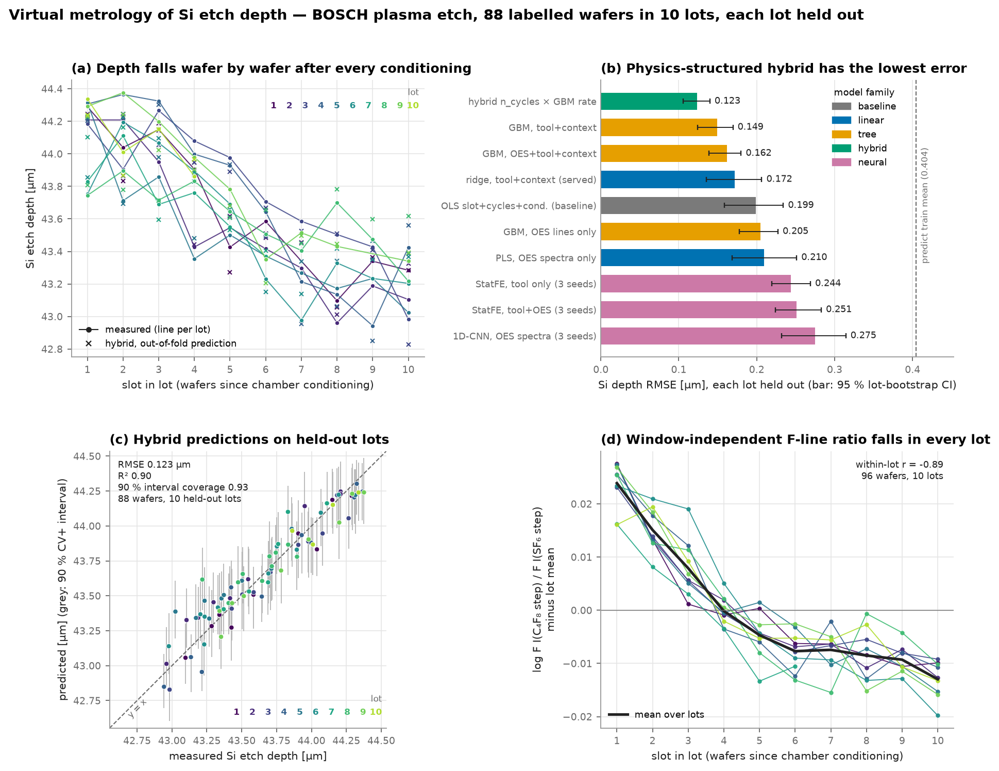

# Plasma-etch virtual metrology (BOSCH DRIE, open data)

Predicts how deep each silicon wafer was etched, and how uniformly, from the etch tool's own sensor logs and
optical emission spectra (OES), before the wafer is measured, with calibrated uncertainty. Built and evaluated
end to end on a public dataset of 96 wafers from a production-class deep-silicon etcher.



*Si etch depth, each of the 10 lots held out in turn (88 labelled wafers): (a) the per-lot drift that dominates
the problem, (b) every key model's error with 95 % lot-bootstrap CIs, (c) the best model's held-out predictions
with 90 % intervals, (d) the optical drift signal behind it.*

## Results at a glance

Leave-one-lot-out RMSE [lot-bootstrap 95 % CI]; predicting the training mean gives 0.404 µm.

| result | value | takeaway |
|---|---|---|
| Best Si-depth model: n_cycles × GBM etch rate (nested selection over 22 configs) | **0.123 µm** [0.106, 0.139] | 38 % below the baseline; chosen in 10/10 folds |
| Served default: pre-declared ridge on tool sensors + run context | 0.172 µm [0.135, 0.206] | better than the baseline, but not significantly for depth |
| Baseline: OLS on wafer slot + cycle count + conditioning | 0.199 µm [0.159, 0.234] | wafer order alone explains most of the depth variation |
| Neural models: 1D-CNN on spectra, StatFE transformer (3 seeds each) | 0.249–0.276 µm | clearly worse than ridge at n = 88 (CIs exclude 0) |
| 90 % prediction intervals, nested CV+ (ridge) | 0.93 coverage, 0.63 µm mean width | ~30 % narrower and steadier than split conformal |
| Robust within-wafer non-uniformity (P5–P95), ridge | 0.112 % [0.083, 0.144] | tool sensors clearly beat the baseline (0.163 %) |

## Key findings

* **Wafer order dominates.** 88 % of the depth variance is within lots: after each chamber conditioning, depth
  falls 0.11–0.16 µm per wafer. A physics-structured hybrid (number of BOSCH cycles × learned rate per cycle)
  captures this best and beats the baseline in all 10 held-out lots.
* **Spectra add no accuracy here** on top of tool sensors and run context (LightGBM +0.013 µm [+0.002, +0.025])
  — except in the one lot with long idle gaps (lot 8), where the spectrum model tracked the wafers after the gaps best.
* **The chamber drifts measurably.** The window-independent ratio F I (passivation step) / F I (etch step) falls
  through every lot (within-lot r = −0.89 with slot, +0.79 with depth), consistent with fluorocarbon build-up
  on the chamber walls.
* **Limitation:** 88 labelled wafers in 10 lots make every CI wide, per-lot interval coverage dips to 0.67, and
  the hybrid candidates were added after the first results were known.

## How it works

* **Data:** [Zenodo 17122442](https://doi.org/10.5281/zenodo.17122442): 1.42 M OES spectra (3648 channels, ~24 Hz),
  31 tool parameters at 5 Hz and 89-point thickness metrology for 88 of the 96 wafers.
* **Ingest:** chunked netCDF → hive-partitioned Parquet (day/lot/wafer/step), MD5- and row-count-verified,
  queried with DuckDB/Polars; the OES wavelength axis is recalibrated per wafer on 17 F I lines (+1.22 nm).
* **Features (1 304 per wafer):** BOSCH phase and cycle segmentation, F I and C₂ line intensities and ratios,
  per-step tool-signal statistics, slot and conditioning context.
* **Models:** OLS, ridge, PLS, LightGBM, PCA/NMF-ridge, the n_cycles × rate hybrid, a 1D-CNN and a StatFE
  transformer (arXiv:2407.06682), compared with leave-one-lot-out CV, lot-bootstrap CIs and nested selection.
* **Intervals:** split-conformal and nested CV+ (Barber et al. 2021).
* **Serving:** FastAPI `/predict` with intervals (ridge default, hybrid "v2" bundle), Streamlit dashboard,
  Dockerfile; CPU latency 0.7 ms (ridge) to 11.6 ms (1D-CNN) per wafer and target.

**Skills demonstrated:** high-volume sensor-data pipelines · physics-based feature discovery · hybrid physics +
ML models · honest evaluation with uncertainty · model serving and dashboards · tested, CI-checked Python
package (33 tests, ruff).

## Reproduce

```bash
uv venv .venv --python 3.12 && source .venv/bin/activate      # Windows: .venv\Scripts\activate
uv pip install torch==2.8.0 --index-url https://download.pytorch.org/whl/cu128   # or the CPU wheel
uv pip install -r requirements-lock.txt && uv pip install --no-deps -e .
python scripts/run_campaign.py --stages data,cpu              # download (MD5) → Parquet → features → tabular models
python scripts/review_analyses.py && python scripts/summarize_results.py && python scripts/make_figures.py
pevm train-nn --config models/statfe_transformer.yaml         # neural models (< 1 GB VRAM; CPU works, slower)
uvicorn plasma_etch_vm.serve.api:app --port 8000              # dashboard: streamlit run src/plasma_etch_vm/dashboard/app.py
pytest -q && ruff check src tests scripts
```

All stages, the cloud-GPU route and the compute used: [`REPORT.md` §12](REPORT.md#12-reproduce).

## Data and licence

The data are not included; `pevm download` fetches them from Zenodo and checks every MD5 ([`DATA.md`](DATA.md)).
Dataset licence **CC BY 4.0**. Please cite: Sayyed, M. A., Seifert, T., Zieger, S., Schwarzenberg, S.,
Deshmukh, A., Haase, M., Langer, J. (2025). *A Multi-Model Dataset for BOSCH Plasma-Etching: Optical Emission
Spectra, Process Parameters, and Wafer Measurements for Data-Driven Plasma Modeling.* Zenodo.
https://doi.org/10.5281/zenodo.17122442

## Limitations

* 88 labelled wafers in 10 lots (one lot = one day = one conditioning recipe): wide CIs, coarse per-lot counts,
  and no guaranteed per-lot interval coverage.
* Wafer slot encodes this DOE; a production tool would need "wafers since clean" and idle time, which vary far
  more than here (only lot 8 has long idle gaps, so an idle-time feature could not be tested).
* The hybrid was chosen after the first results, hyper-parameters are defaults, and there is no external test set.

## More

Everything else (all targets, per-site maps, physics tables, the idle-time test, compute used, repository layout
and references) is in **[`REPORT.md`](REPORT.md)**.
