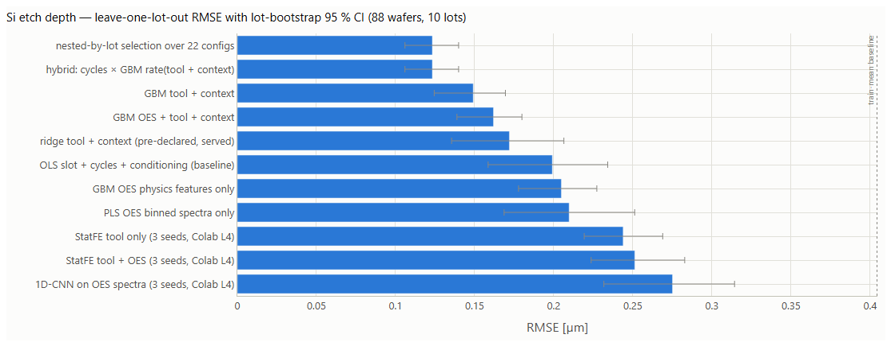

# Plasma-etch virtual metrology (BOSCH DRIE, open data)

Predicts how deep each silicon wafer was etched — and how uniformly — from the plasma-etch tool's own sensor
logs and optical emission spectra, before the wafer is measured, with calibrated uncertainty. Built and
evaluated end to end on a public dataset of 96 wafers from a production-class deep-silicon etcher
([Zenodo 17122442](https://doi.org/10.5281/zenodo.17122442), CC BY 4.0).



*Si etch-depth error of every model, each lot held out in turn (88 labelled wafers, 10 lots); bars are RMSE,
whiskers lot-bootstrap 95 % CIs, dashed line = predicting the training mean (0.404 µm).*

## Results at a glance

Leave-one-lot-out, 88 labelled wafers in 10 lots; [ ] = lot-bootstrap 95 % CI.

| result | value | takeaway |
|---|---|---|
| Best Si-depth model: depth = n_cycles × GBM etch rate (nested selection over 22 configs) | **0.123 µm** RMSE [0.106, 0.139] | 38 % below the physics baseline; chosen in 10/10 folds |
| Served default: pre-declared ridge on tool sensors + run context | 0.172 µm [0.135, 0.206] | better than the baseline, but not significantly for depth |
| Physics baseline: OLS on wafer slot + cycle count + conditioning | 0.199 µm [0.159, 0.234] | wafer order alone explains most of the depth variation (train mean: 0.404 µm) |
| Neural models: 1D-CNN on spectra, StatFE transformer (3 seeds each) | 0.249–0.276 µm | clearly worse than ridge at n = 88 (Δ +0.065 … +0.072 µm, CIs exclude 0) |
| Adding optical emission spectra to tool + context (LightGBM) | +0.013 µm [+0.002, +0.025] | spectra add no accuracy in this dataset |
| 90 % prediction intervals, nested CV+ (ridge) | 0.93 coverage, 0.63 µm mean width | ~30 % narrower and steadier than split conformal (0.92 µm) |
| Robust within-wafer non-uniformity (P5–P95), ridge | 0.112 % [0.083, 0.144] | tool sensors beat the baseline (0.163 %) clearly here |
| CPU inference latency per wafer and target | 0.7 ms (ridge) … 11.6 ms (1D-CNN) | API round trip for 5 targets ~15 ms |

## Key findings

* **Wafer order dominates.** 88 % of the depth variance is within lots: after each chamber conditioning, depth
  falls 0.11–0.16 µm per wafer. A physics-structured hybrid (number of BOSCH cycles × learned rate per cycle)
  captures this best and beats the baseline in all 10 held-out lots.
* **Spectra add nothing here** on top of tool sensors and run context — except in the one lot with long idle
  gaps (lot 8), where only the spectrum model stayed within ±0.2 µm on the wafers after the gaps.
* **The chamber drifts measurably.** The window-independent ratio F I (passivation step) / F I (etch step)
  falls through every lot (within-lot r = −0.89 with slot, +0.79 with depth), consistent with fluorocarbon
  build-up on the chamber walls.
* **Simple models win at this size.** With 88 labelled wafers, ridge beats the 1D-CNN and the StatFE
  transformer clearly (lot-bootstrap CIs exclude 0); LightGBM is not distinguishable from ridge.
* **Limitation:** 88 wafers in 10 lots (lot 10 has only 4 labelled), so every CI is wide; the hybrid candidates
  were added after the first results (nested selection guards the choice among them, not how the list was
  built), and per-lot interval coverage dips to 0.67.

Full technical write-up with every table, CI and caveat: **[`REPORT.md`](REPORT.md)**.

## Results in detail

| target (train-mean RMSE) | baseline: OLS slot + cycles + conditioning | pre-declared ridge, tool + context (served) | nested-by-lot best of 22 configs |
|---|---|---|---|
| Si depth, µm (0.404) | 0.199 [0.159, 0.234] | **0.172 [0.135, 0.206]** | **0.123 [0.106, 0.139]** (cycles × GBM rate, chosen in 10/10 folds) |
| robust non-uniformity P5–P95, % (0.184) | 0.163 [0.112, 0.204] | 0.112 [0.083, 0.144] | — |
| Si edge − centre, µm (0.199) | 0.173 [0.138, 0.201] | 0.127 [0.108, 0.145] | — |
| SiO₂ mask loss, µm (0.048) | 0.057 [0.039, 0.072] | 0.041 [0.033, 0.049] | — |
| selectivity (5.13) | 5.92 [4.15, 7.48] | 4.32 [3.42, 5.11] | — |
| per-site Si depth, µm (site-mean 0.484) | — | ridge rate × radial shape 0.312 | — |

* Si depth: ridge vs baseline −0.027 µm [−0.064, +0.014] (not significant); hybrid vs baseline −0.076 µm
  [−0.113, −0.039]; LightGBM (0.149 µm) vs ridge −0.023 [−0.056, +0.009], 5/10 lots.
* Neural models, Si depth RMSE mean ± std over 3 seeds: 1D-CNN on OES spectra 0.276 ± 0.007 µm, StatFE
  transformer tool + OES 0.256 ± 0.008, tool only 0.249 ± 0.013; for robust non-uniformity and mask loss
  they are close to the linear models.
* Model errors are ~4–5× the metrology noise floor (0.031 µm per campaign, same-site comparison).
* Half-range non-uniformity (dominated by single bad sites) is not predictable; mask loss and selectivity are
  weak targets (their labels agree poorly between the two metrology campaigns, r = 0.21).
* The C₂ *share* of emission rises with slot only because total emission falls faster; viewport coating cannot
  be excluded for absolute intensities.
* An exploratory idle-time feature test found no lot-held-out gain, because only lot 8 has long idle gaps.

Serving: the pre-declared ridge bundle (all targets) is the default; a **v2 candidate** (`pevm export-v2`:
n_cycles × GBM rate with CV+ intervals, Si depth only) is available.

## Method

```
Day_*.nc (OES, uint16 dictionary codes)  ─┐   per-wafer, chunk-aligned reads (HDF5 chunk ≈ 5000 rows)
Process_data.nc (31 params @ 5 Hz)       ─┼─► wavelength calibration on 17 NIST F I lines (RMS ≤ 0.024 nm)
Si_Oxide_etch_89_points.csv              ─┘   phase / cycle segmentation (SF₆ 4.5 s / C₄F₈ 1.5 s, 100 cycles)
                                              └─► data/parquet/{oes,process,oes_trace}/day=/lot=/wafer=/step=
per-cycle tables → wafer features (1 304): tool · timing · OES lines · ratios · transitions · slot/conditioning · spectra
   → leave-one-lot-out CV (10 folds) · lot-bootstrap 95 % CIs · nested-by-lot model selection
   → OLS / ridge / PLS / LightGBM / PCA- & NMF-ridge / hybrid cycles × rate · 1D-CNN · StatFE transformer
   → split-conformal and CV+ intervals → FastAPI + Streamlit
```

The data: 96 wafers, 1 420 272 optical emission spectra (3648 channels, ~24 Hz), 31 tool parameters at 5 Hz,
and 89-point thickness metrology for 88 wafers. I found no published virtual-metrology benchmark on this
dataset (search in November 2026, not exhaustive), so this repo aims to be an open, reproducible one.

Key data findings (details in [`docs/data_schema.md`](docs/data_schema.md)): the stored OES wavelength
axis is offset by −1.22 nm (recalibrated per wafer, +1.221 ± 0.004 nm over all 96); only F I and C₂ Swan
emission is detectable (no actinometer gas, [`docs/line_detection.md`](docs/line_detection.md)); detector
baseline jitter makes the raw channel sum unusable as a plasma signal; OES (epoch) and tool (relative) clocks
are not alignable; the 9-point metrology is rotated 180° vs the 89-point table.

## Skills demonstrated

| area | where it is in this repo |
|---|---|
| scalable pipelines for high-volume, many-channel sensor data | `ingest.py`: chunked netCDF → hive-partitioned Parquet (day/lot/wafer/step), 3648 + 31 channels, memory-bounded, idempotent manifest, row-level verification; 5.18 G channel-values ingested; DuckDB/Polars query layer (`store.py`, full-store count 3.4 s) |
| physics-based feature discovery | BOSCH cycle segmentation from the tool log *and* OES; automatic wavelength recalibration; emission-line detection; window-independent F-ratio drift through each lot; idle-time effect in lot 8 |
| hybrid physics + ML models | depth = n_cycles × rate(features); per-site model = wafer rate × learned radial profile; transformer with statistical feature embedding (arXiv:2407.06682) |
| honest evaluation and uncertainty | leave-one-lot-out CV, lot-bootstrap CIs on every comparison, nested model selection, split-conformal and CV+ intervals |
| accuracy vs speed trade-offs | CPU inference latency per model (0.7 ms ridge → 12 ms CNN) next to its accuracy |
| serving and dashboards | FastAPI `/predict` with conformal intervals + Dockerfile; Streamlit dashboard (pred vs actual, top features, OES line viewer, wafer maps) |
| clean, extendable code | src-layout package, YAML configs, MLflow tracking, 33 CPU tests, ruff, GitHub Actions CI |

## Reproduce

```bash
uv venv .venv --python 3.12
source .venv/bin/activate                     # Windows: .venv\Scripts\activate
uv pip install torch==2.8.0 --index-url https://download.pytorch.org/whl/cu128   # or the CPU wheel
uv pip install -r requirements-lock.txt
uv pip install --no-deps -e .

# whole campaign: download (3 streams, MD5) -> ingest -> verify -> delete raw day file; CPU stages; neural runs
python scripts/run_campaign.py --stages data,cpu,gpu     # resumable, log: outputs/campaign.log
python scripts/review_analyses.py                        # bootstrap CIs, nested selection, CV+, hybrid, physics
python scripts/idle_features.py                          # exploratory idle-time features
python scripts/summarize_results.py                      # tables + figures

# individual stages
pevm download | ingest | query-bench | cycles | lines | features | benchmark | points | interpret | export | export-v2
pevm train-nn --config models/cnn1d.yaml                 # < 1 GB VRAM; CPU works too (slower)
python scripts/pack_nn_inputs.py                         # 5 MB tar.gz of per-wafer tensors + code for a cloud GPU
#   on the GPU machine: bash pack/code/scripts/colab_run_nn.sh   (all 9 neural runs, resumable)

# serve / visualise (CPU)
uvicorn plasma_etch_vm.serve.api:app --port 8000         # GET /health /model /predict/{wafer_id}; POST /predict
streamlit run src/plasma_etch_vm/dashboard/app.py
mlflow ui --backend-store-uri sqlite:///mlruns/mlflow.db
pytest -q && ruff check src tests scripts
```

Config values can be overridden on the command line (`pevm benchmark cv.scheme=lolo`). On a shared GPU,
set `GPU_GUARD` to the path of a GPU-scheduler wrapper script and the campaign runs every neural job through
it with a 1 GB reservation; unset, jobs start directly. Docker: `pevm export && docker build -t plasma-etch-vm:0.1 .`
(the Dockerfile is provided but was not built for this release). Colab: `notebooks/colab_launcher.ipynb`.

Compute used for the reported results: a laptop CPU for download, ingestion, features and all tabular models
(about 1 h of wall time for the campaign stages, REPORT §8), and one NVIDIA L4 on Google Colab for the 9 neural
runs (13.1 min of training).

## Repository layout

```
configs/            data.yaml, features.yaml, models/{tabular,cnn1d,statfe_transformer}.yaml
src/plasma_etch_vm/ zenodo, netcdf_io, ingest, store, segmentation, lines, metrology, features/, models/,
                    pipeline, reports, tracking, serve/api.py, dashboard/{app,figures}.py, cli.py
scripts/            run_campaign.py, review_analyses.py, idle_features.py, summarize_results.py, render_figures.py,
                    pack_nn_inputs.py, colab_run_nn.sh, make_colab_notebook.py
notebooks/          colab_launcher.ipynb
tests/              synthetic netCDF fixtures + CPU tests
docs/               data_schema.md, line_detection.md, figures/
```

## Data and licence

The data are **not** included in this repository; `pevm download` fetches them from Zenodo and checks every
MD5 (sizes, checksums and layout: [`DATA.md`](DATA.md)). Dataset licence: **CC BY 4.0**. Please cite:

> Sayyed, M. A., Seifert, T., Zieger, S., Schwarzenberg, S., Deshmukh, A., Haase, M., Langer, J. (2025).
> *A Multi-Model Dataset for BOSCH Plasma-Etching: Optical Emission Spectra, Process Parameters, and Wafer
> Measurements for Data-Driven Plasma Modeling.* Zenodo. https://doi.org/10.5281/zenodo.17122442

## Limitations

* 88 labelled wafers in 10 lots (one lot = one day = one conditioning recipe); per-lot coverage of the
  intervals is not guaranteed, and "lots won" counts are coarse.
* Slot (wafer position after conditioning) is legitimate run context here but encodes the DOE; a production
  tool would need "wafers since clean" and idle time, which vary far more than in this dataset.
* The hybrid candidates were added after the first results were known; nested selection guards the choice
  among the 22 configs, not how the list was built.
* Gas identities (SF₆ = Gas5, C₄F₈ = Gas4) are inferred from duty cycles; the 9-point metrology table is
  not used for training (rotated frame, offset, two lots missing).
* Tabular and neural hyper-parameters are defaults (no nested hyper-parameter search).

## Full report

Methods, every result table with CIs, physics interpretation, compute used and negative results:
**[`REPORT.md`](REPORT.md)**.

## References

* Sayyed et al. (2025), Zenodo 17122442 — the dataset (above).
* Lee, G. T., Kwon, O.-R. (2024). *A Predictive Model Based on Transformer with Statistical Feature Embedding
  in Manufacturing Sensor Dataset.* [arXiv:2407.06682](https://arxiv.org/abs/2407.06682) — reimplemented here.
* Pamarty, A. P., Neuweiler, R., Do, L. Q., Johnson, K., Sanchez, J. J., Koli, D. (2024). *Data-driven
  surrogate model for etch rate profiles using sensor data from a reactive ion etcher.*
  [arXiv:2409.12925](https://arxiv.org/abs/2409.12925).
* Barber, Candès, Ramdas, Tibshirani (2021), *Predictive inference with the jackknife+*, Ann. Statist. 49(1)
  (CV+); Vovk, Gammerman, Shafer (2005), *Algorithmic Learning in a Random World* (split conformal).
* McCann, M., Johnston, A. (2008). *SECOM* [dataset]. UCI ML Repository, https://doi.org/10.24432/C54305
  (optional sanity dataset, not used).
* NIST Atomic Spectra Database (F I lines); Pearse & Gaydon (C₂ Swan band heads).
