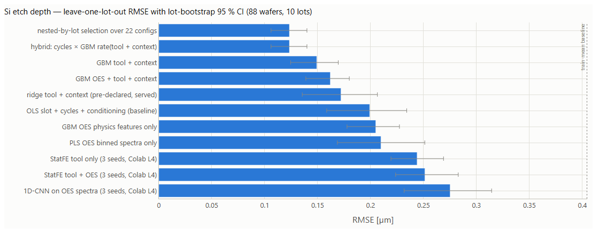
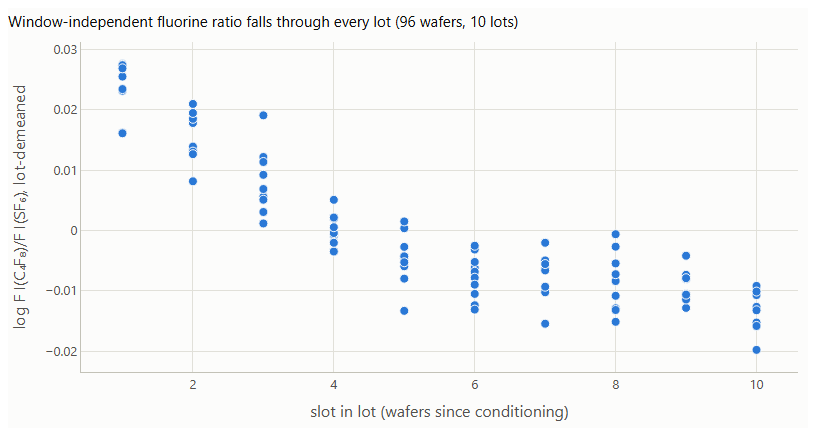
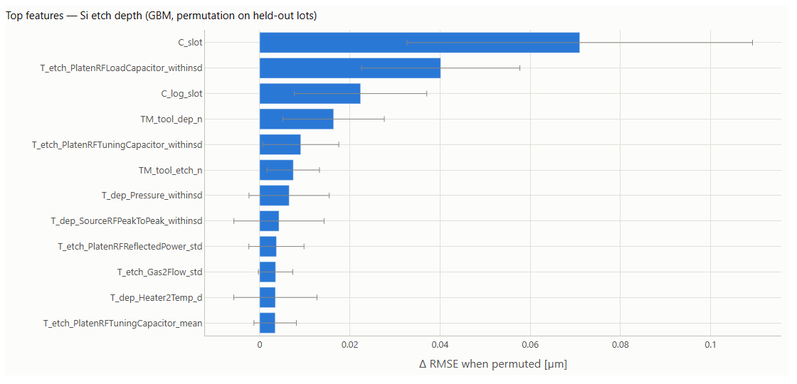

# REPORT — Virtual metrology for BOSCH plasma etching (Zenodo 17122442), all wafers

Every number comes from run outputs: `outputs/benchmark/` (leave-one-lot-out predictions),
`outputs/review/review_analyses.{md,json}` + `bootstrap_*.csv` + `*_oof.parquet` (bootstrap CIs, nested
selection, CV+, hybrid, physics checks — `scripts/review_analyses.py`), `outputs/summary/summary.{md,json}`
(`scripts/summarize_results.py`), `outputs/nn/`, `outputs/campaign.log`, `data/parquet/_manifest/`, MLflow
(`mlruns/mlflow.db`). These outputs are not part of the repository; the commands in section 12 regenerate them.

## 1. Summary

* **Data:** all 10 OES day files (96 wafers, 1 420 272 spectra × 3648 channels), the full tool log
  (96 wafers × 31 parameters @ 5 Hz) and the 89-point metrology (**88 labelled wafers in 10 lots; lot 7 has 6,
  lot 10 only 4 labelled wafers**). Evaluation is always leave-one-lot-out (10 folds); 95 % CIs resample whole
  lots (2 000 bootstrap draws).
* **What the problem really is:** 88 % of the Si-depth variance is *within* lots. Each lot loses depth
  wafer by wafer after conditioning (−0.11 … −0.16 µm/slot in 9 of 10 lots); slot + the logged cycle count
  explain the within-lot spread down to SD 0.106 µm in-sample. The pre-declared reference baseline (OLS on
  slot + cycle count + conditioning, lot-held-out) reaches **0.199 µm [0.159, 0.234]** (train mean: 0.404 µm).
* **Pre-declared model (ridge, tool + context, the served model):** **0.172 µm [0.135, 0.206]**, better than
  the slot baseline by only −0.027 µm [−0.064, +0.014] (7/10 lots) — **not significant**. LightGBM on the same features (0.149 µm;
  −0.050 [−0.090, −0.012] vs the baseline) is
  *not* distinguishable from ridge (Δ −0.023 [−0.056, +0.009], wins 5/10 lots) — it was the best of 19
  benchmark configs, so its single number is selection-biased and is not used as the headline.
* **Nested-by-lot selection (honest best-model estimate):** choosing among 22 configs (19 benchmark +
  3 physics-structured hybrids) inside each outer fold gives **0.123 µm [0.106, 0.139]**, Δ −0.049 µm
  [−0.079, −0.018] vs the pre-declared ridge. The inner search picked the same config in all 10 folds: the
  hybrid **depth = n_cycles × rate**, rate learned by LightGBM from tool + context features. Caveat: the
  hybrid candidates were added after seeing the first results, so the nested
  estimate protects against picking among the 22, not against how the 22 were chosen.
* **OES:** on its own it predicts depth (PLS on binned spectra 0.210 µm [0.169, 0.251]; GBM on line
  features 0.205 [0.178, 0.227]), but **adding it to tool + context does not help** (GBM +0.013 µm
  [+0.002, +0.025] *worse*, 2/10 lots) and OES features do not explain the tool model's residuals
  (every residual model increases the error). One informative exception: lot 8, where long idle times
  broke the slot pattern (section 7).
* **Uncertainty:** split-conformal (calibrated on 2 lots ≈ 20 wafers) gives 0.94–0.96 marginal coverage but
  unstable widths; nested CV+ keeps 0.93 coverage with ~30 % narrower and more stable intervals (ridge: mean
  width 0.63 vs 0.92 µm). Per-lot coverage still dips to 0.67 for the smallest lots.
* **Noise floor:** wafer means of the two metrology campaigns at the same 9 sites differ by SD 0.044 µm
  (≈ 0.031 µm per campaign); comparing different site sets instead gives 0.089 µm and overstates the noise. Model errors (0.12–0.17 µm)
  are ~4–5× the metrology noise — there is model headroom, but little within this DOE.
* **Physics:** what is window-independent is the same-line ratio F I (C₄F₈
  step) / F I (SF₆ step), which falls through every lot (within-lot r = −0.89, −3.5 % from slot 1 to 10) and
  tracks depth (r = +0.79). Absolute C₂ emission *falls* with slot (−3.9 %, r = −0.75) together with total
  emission (−7.1 % in the C₄F₈ step); a rising C₂ *share* of emission is only an artifact of normalising by total emission.
  Viewport coating and a weaker plasma cannot be separated from absolute intensities.
* **Neural models (Colab L4, 3 seeds):** 1D-CNN on spectra 0.276 ± 0.007 µm, StatFE transformer
  0.256 ± 0.008 (tool + OES) / 0.249 ± 0.013 (tool only) for Si depth — all significantly worse than linear
  models on the same information (Δ +0.065 … +0.072 µm, CIs exclude 0) and worse than the slot baseline (0.199 µm).

## 2. Data actually used

| item | value |
|---|---|
| source | Zenodo record 17122442 (CC BY 4.0), DOI 10.5281/zenodo.17122442 |
| downloaded | all 18 files, 7.91 GB; day files MD5-verified, ingested, row-verified, then deleted to bound disk use; the remaining raw files take 9.7 MB |
| download | 9 day files, 7.43 GB in 29.1 min with 3 parallel streams = 4.25 MB/s (first day file, 1 stream: 0.24 MB/s) |
| OES | 10 days, 96 wafers, 1 420 272 spectra, 3648 channels (5.18 G channel-values) |
| tool log | 96 wafers, 313 169 rows, 31 common parameters |
| labels | 89-point table: 88 wafers × 89 sites = 7 832 measurements. Per lot: 9, 10, 10, 10, 10, 10, 6, 10, 9, **4** |
| splits | leave-one-lot-out (one lot = one day = one conditioning recipe); split-conformal calibration on 2 held-out training lots; CV+ on all 9 training lots |
| derived store | Parquet OES 6.35 GB (`counts_i16`), process 17 MB, traces + cycle tables + features 330 MB |

Per-day ingestion (concurrent with the next downloads): 116–180 s per 10-wafer day, 830–1 270 spectra/s
(3.0–4.6 M channel-values/s); every wafer's Parquet row count matched the netCDF before deletion
(table in `outputs/summary/summary.md`). Ingesting a single day in isolation reached 3 900 spectra/s.

## 3. Pipeline and query layer

* Wavelength recalibration on all 96 wafers: shift +1.221 ± 0.004 nm (range +1.214 … +1.228), ≥ 13 F I
  lines per wafer, max residual RMS 0.024 nm, fallback never used.
* Detected lines on all wafers: ten F I lines (SNR 13.5–241.9) and three C₂ Swan bands (SNR 21.8–119.3);
  no Si, SiF, CF₂, O, Ar, He (`docs/line_detection.md`).
* DuckDB / Polars over the hive-partitioned store (1 420 272 OES rows): `count(*)` 188.4 s → 3.4 s and the
  F I line query (37 of 3 648 columns, 986 380 rows) 16.9 s → 3.8 s after switching off `union_by_name`
  (all partitions share one validated schema).

## 4. Wafer-level results (leave-one-lot-out, 88 wafers, lot-bootstrap 95 % CIs)



### Si etch depth (train-mean RMSE 0.404 µm)

| config | RMSE µm [95 % CI] | Δ vs ridge tool+ctx [CI] | lots won vs ridge | Δ vs slot baseline [CI] |
|---|---|---|---|---|
| OLS slot + cycles + conditioning (baseline) | 0.199 [0.159, 0.234] | +0.027 [−0.014, +0.064] | 3/10 | — |
| ridge context only (slot + conditioning, no cycle count) | 0.247 [0.204, 0.288] | +0.075 [+0.027, +0.118] | 2/10 | +0.047 [+0.022, +0.066] |
| **ridge tool + context (pre-declared, served)** | **0.172 [0.135, 0.206]** | — | — | −0.027 [−0.064, +0.014] |
| ridge tool only | 0.177 [0.133, 0.218] | +0.005 [−0.006, +0.017] | 6/10 | −0.022 [−0.068, +0.029] |
| GBM tool + context | 0.149 [0.124, 0.169] | −0.023 [−0.054, +0.008] | 5/10 | −0.050 [−0.090, −0.012] |
| GBM OES + tool + context | 0.162 [0.139, 0.180] | −0.010 [−0.043, +0.021] | 4/10 | −0.037 [−0.075, +0.002] |
| ridge OES + tool + context | 0.182 [0.139, 0.222] | +0.010 [−0.023, +0.032] | 4/10 | −0.017 [−0.068, +0.033] |
| GBM OES line features only | 0.205 [0.178, 0.227] | +0.033 [−0.016, +0.075] | 2/10 | +0.006 [−0.032, +0.047] |
| PLS OES binned spectra only | 0.210 [0.169, 0.251] | +0.038 [−0.020, +0.093] | 4/10 | +0.011 [−0.036, +0.055] |
| hybrid: cycles × ridge rate(tool + ctx) | 0.160 [0.117, 0.207] | −0.012 [−0.037, +0.011] | 7/10 | −0.039 [−0.093, +0.022] |
| hybrid: cycles × GBM rate(tool + ctx) | 0.123 [0.106, 0.140] | −0.049 [−0.078, −0.016] | 8/10 | −0.076 [−0.113, −0.039] |
| **nested-by-lot selection (22 configs)** | **0.123 [0.106, 0.139]** | −0.049 [−0.079, −0.018] | — | −0.076 [−0.113, −0.039] (10/10 lots) |

All 19 benchmark configs with CIs: `outputs/review/bootstrap_si_etch_mean.csv`.

### Other targets (pre-declared ridge vs baseline and best alternatives)

| target (train-mean RMSE) | config | RMSE [95 % CI] | Δ vs ridge tool+ctx [CI] | Δ vs slot baseline [CI] |
|---|---|---|---|---|
| robust non-uniformity P5–P95, % (0.184) | ridge tool + context | 0.112 [0.083, 0.144] | — | −0.051 [−0.080, −0.018] |
| | ridge tool only | 0.108 [0.079, 0.142] | −0.004 [−0.006, −0.001] | −0.055 [−0.087, −0.020] |
| | GBM tool + context | 0.130 [0.087, 0.172] | +0.019 [+0.000, +0.033] | −0.033 [−0.062, −0.005] |
| | OLS slot baseline | 0.163 [0.112, 0.204] | +0.051 [+0.019, +0.080] | — |
| Si edge − centre, µm (0.199) | ridge tool + context | 0.127 [0.108, 0.145] | — | −0.051 [−0.081, −0.015] |
| | PLS OES spectra | 0.131 [0.099, 0.157] | +0.005 [−0.022, +0.029] | −0.046 [−0.081, −0.014] |
| | OLS slot baseline | 0.173 [0.138, 0.201] | +0.046 [+0.013, +0.072] | — |
| SiO₂ mask loss, µm (0.048) | ridge tool + context | 0.041 [0.033, 0.049] | — | −0.016 [−0.029, −0.002] |
| | ridge tool only | 0.037 [0.030, 0.043] | −0.004 [−0.007, −0.002] | −0.021 [−0.035, −0.006] |
| | GBM tool + context | 0.055 [0.039, 0.068] | +0.014 [−0.002, +0.028] | −0.003 [−0.027, +0.018] |
| selectivity (5.13) | ridge tool + context | 4.315 [3.419, 5.107] | — | −1.624 [−2.883, −0.193] |
| | ridge tool only | 3.823 [3.081, 4.431] | −0.492 [−0.794, −0.167] | −2.116 [−3.547, −0.558] |
| half-range non-uniformity, % (1.391) | ridge tool + context | 1.385 [0.285, 2.428] | — | −0.007 [−0.244, +0.064] |
| | GBM tool + context | 1.518 [0.632, 2.495] | +0.133 [+0.059, +0.471] | +0.126 [+0.078, +0.415] |

Half-range non-uniformity is not predictable (single bad sites; CI spans 0.3–2.4 %); the robust P5–P95
version is. Mask loss and selectivity are weak (their labels disagree between metrology campaigns,
r = 0.21); GBM over-fits them.

### Per-site Si depth (88 wafers × 89 sites = 7 832 points)

| model | RMSE µm | MAE µm | R² | RMSE / site-mean baseline |
|---|---|---|---|---|
| site mean (no wafer information) | 0.484 | 0.359 | 0.982 | 1.000 |
| ridge wafer rate × learned radial shape | 0.312 | 0.167 | 0.993 | 0.644 |
| LightGBM on wafer features + (x, y, r, r²) | 0.313 | 0.171 | 0.992 | 0.647 |

R² is high for every per-site model because the radial edge-fast profile (41.7 µm at r ≤ 0.25 R vs 46.2 µm
at r ≥ 0.75 R on average) dominates the variance; the RMSE ratio is the informative number.

### Prediction intervals: split conformal vs nested CV+ (Si depth, nominal 90 %)

| config | split coverage | split min lot | split mean width µm | split half-width by lot | CV+ coverage | CV+ min lot | CV+ mean width µm | CV+ half-width by lot |
|---|---|---|---|---|---|---|---|---|
| ridge tool + context | 0.943 | 0.667 | 0.915 | 0.274–0.593 | 0.932 | 0.667 | 0.628 | 0.239–0.365 |
| GBM tool + context | 0.955 | 0.800 | 0.685 | 0.232–0.465 | 0.932 | 0.750 | 0.587 | 0.258–0.325 |
| hybrid cycles × GBM rate | – | – | – | – | 0.932 | 0.800 | 0.435 | 0.204–0.241 |
| OLS slot baseline | 0.943 | 0.600 | 0.985 | 0.296–0.986 | 0.898 | 0.600 | 0.948 | 0.273–0.935 |

Split conformal used round(0.25 × 9) = 2 calibration lots (≈ 20 wafers) per fold — hence the width swings.
CV+ (Barber et al. 2021) uses inner leave-one-lot-out residuals of all 9 training lots. Marginal coverage
holds; conditional (per-lot) coverage does not reach 0.9 for every chamber state with either method.

### v2 candidate served bundle (hybrid with CV+ intervals)

`pevm export-v2` writes `outputs/model_bundle_v2.joblib`: Si depth = n_cycles (tool log) × LightGBM rate(tool +
context), with the 10 leave-one-lot-out fold models and their residuals stored so the API returns **CV+**
intervals for a new wafer (`PEVM_BUNDLE=outputs/model_bundle_v2.joblib uvicorn plasma_etch_vm.serve.api:app`).
Leave-one-lot-out RMSE 0.123 µm; nested CV+ coverage 0.932 (min lot 0.80), mean width 0.435 µm (table above).
The pre-declared ridge bundle (`outputs/model_bundle.joblib`, all targets) stays the **default**. Note: the
hybrid was chosen after the first results were known (nested selection guards the choice among 22 configs,
not the construction of that list); v2 serves Si depth only.

## 5. Neural models (Colab L4)

**Where and how:** all 9 runs (R3 1D-CNN, R4 StatFE tool + OES, R5 StatFE tool only; 3 seeds each) ran on one
**NVIDIA L4 on Google Colab**. Inputs were the exact per-wafer tensors the local pipeline builds (`scripts/pack_nn_inputs.py`, 5.06 MB packed; no raw data uploaded); same
leave-one-lot-out folds, seeds 0–2, targets (Si depth, robust non-uniformity `si_nu_p90_pct`, mask loss),
configs and cross-conformal intervals as locally. VM: NVIDIA L4 23 GB, Python 3.13.16, torch 2.14.1+cu130,
CUDA 13.0 (library versions differ from the local lock file). Training wall time 13.1 min for all 9 runs
(78–114 s each), peak VRAM 66–99 MB, 1.25 Colab compute units.

| model (Colab L4) | params | target | RMSE mean ± std (3 seeds) | R² mean ± std | interval coverage |
|---|---|---|---|---|---|
| 1D-CNN on window-averaged OES spectra | 204 515 | Si depth, µm | 0.276 ± 0.007 | 0.522 ± 0.024 | 0.902 |
| | | robust NU, % | 0.155 ± 0.001 | 0.209 ± 0.012 | 0.864 |
| | | mask loss, µm | 0.040 ± 0.001 | 0.129 ± 0.028 | 0.894 |
| StatFE transformer, tool + OES tokens | 10 877 | Si depth, µm | 0.256 ± 0.008 | 0.589 ± 0.027 | 0.917 |
| | | robust NU, % | 0.133 ± 0.001 | 0.420 ± 0.009 | 0.886 |
| | | mask loss, µm | 0.040 ± 0.001 | 0.142 ± 0.057 | 0.890 |
| StatFE transformer, tool tokens only | 8 357 | Si depth, µm | 0.249 ± 0.013 | 0.612 ± 0.042 | 0.909 |
| | | robust NU, % | 0.134 ± 0.003 | 0.413 ± 0.025 | 0.867 |
| | | mask loss, µm | 0.039 ± 0.002 | 0.172 ± 0.068 | 0.894 |

Paired comparison of each 3-seed ensemble with a tabular model given comparable information (lot bootstrap):

| target | neural ensemble | vs tabular | RMSE neural / tabular | Δ [95 % CI] | lots neural wins |
|---|---|---|---|---|---|
| Si depth | 1D-CNN | PLS on the same binned spectra | 0.275 / 0.210 | +0.065 [+0.033, +0.098] | 1/10 |
| Si depth | StatFE tool + OES | ridge OES + tool + context | 0.251 / 0.182 | +0.069 [+0.027, +0.110] | 1/10 |
| Si depth | StatFE tool only | ridge tool only | 0.244 / 0.177 | +0.067 [+0.025, +0.113] | 2/10 |
| Si depth | StatFE tool only | ridge tool + context (served) | 0.244 / 0.172 | +0.072 [+0.037, +0.110] | 1/10 |
| robust NU | StatFE tool only | ridge tool only | 0.132 / 0.108 | +0.024 [+0.002, +0.041] | 2/10 |
| robust NU | StatFE tool + OES | ridge OES + tool + context | 0.132 / 0.119 | +0.012 [−0.012, +0.030] | 6/10 |
| mask loss | StatFE tool + OES | ridge OES + tool + context | 0.040 / 0.046 | −0.006 [−0.012, +0.001] | 7/10 |
| mask loss | 1D-CNN | PLS on the same spectra | 0.040 / 0.045 | −0.005 [−0.016, +0.005] | 8/10 |

Reading: with 79 training wafers per fold the neural models are clearly worse than linear models for Si depth
(every CI excludes zero; they are worse than the slot + cycles OLS baseline, 0.199 µm) and somewhat worse for the
robust non-uniformity; for mask loss everything sits near the train-mean baseline (0.048 µm) and the
differences are not significant. Neither network receives the slot / conditioning context, but the
StatFE-tool-only vs ridge-tool-only comparison (same information, no context) shows the gap is not only
missing context. No hyper-parameter search was run (a sweep not nested inside the lot folds would bias the
comparison), so these are default
configurations; given the size of the gap, tuning is unlikely to change the conclusion for this dataset.
The transformer is the published StatFE design (arXiv:2407.06682) reimplemented; its originally reported
setting (488 observations, daily sliding windows) is larger and differently split than ours.

## 6. Physics interpretation

Within-lot correlations (each lot's mean removed; 96 wafers vs slot, 88 vs depth) and the change from
slot 1 to slot 10 implied by the pooled within-lot slope:

| signal (per-wafer mean over BOSCH cycles) | r with slot | % change slot 1→10 | r with Si depth | depends on window transmission? |
|---|---|---|---|---|
| F I 685.6 nm, C₄F₈ step / same line, SF₆ step | −0.89 | −3.5 % | +0.79 | **no** (same line, same window) |
| C₂ Swan 516.5 nm, C₄F₈ step, absolute | −0.75 | −3.9 % | — | yes |
| total emission, C₄F₈ step, absolute | −0.90 | −7.1 % | — | yes |
| C₂ share of total emission, C₄F₈ step | +0.79 | +3.1 % | −0.77 | partly cancels |
| F I 685.6 nm, SF₆ step, absolute | −0.82 | −5.1 % | — | yes |
| total emission, SF₆ step, absolute | −0.78 | −3.0 % | — | yes |
| F I share of total, SF₆ step | −0.66 | −2.1 % | +0.62 | partly cancels |
| platen RF load-capacitor re-tuning within the SF₆ step (tool) | +0.76 | — | −0.73 | n/a |

What can be said: every lot starts from a cleaned and conditioned chamber, and from wafer to wafer the
plasma state drifts monotonically — all absolute emission falls, the RF match re-tunes harder within each
step, and the fluorine signal in the passivation step falls relative to the etch step (a ratio that the
viewport cannot fake). Si depth falls in step. A fluorocarbon film building up on the walls (more F lost
to the walls, a slowly changing plasma impedance) is a consistent explanation, but this dataset cannot
separate it from viewport coating for the absolute intensities, and a rising C₂ *share* is only an
artifact of normalising by total emission. The drift saturates: averaged over lots (lot means
removed), the log F-ratio goes +0.024 → −0.008 from slot 1 to slot 6 (≈ 85 % of its total change) and only
to −0.013 by slot 10, while depth goes +0.43 → −0.35 µm from slot 1 to slot 8 and −0.45 µm at slot 10 —
an approach to a conditioned steady state rather than a linear trend, with depth lagging the gas-phase
signal by a few wafers. The depth slope is −0.11 … −0.16 µm/slot in 9 of 10
lots irrespective of the conditioning recipe (1/3/9 repeats on chuck, Si or SiO₂), consistent with the
dataset authors' finding that conditioning had no clear effect; lot 8 is the exception (−0.056 µm/slot,
section 7).

Model attributions (permutation importance on held-out lots, GBM tool + context, Si depth): slot
(ΔRMSE 0.071 µm), platen RF load-capacitor within-step variability (0.040), log slot (0.022), number of
C₄F₈ / SF₆ steps logged (0.016 / 0.007). For robust non-uniformity the platen RF peak-to-peak voltage in
the C₄F₈ step dominates (ion-energy proxy). The hybrid result (depth = cycles × rate) supports the simple
physical prior that each BOSCH cycle removes a near-constant depth that drifts with chamber state.




## 7. Idle time matters: lot 8

Idle times are not constant in this DOE. Plasma-on to plasma-on gaps are
691 s (median) except in lot 8 (2024-08-07): **1 411 s before wafer 8 and 1 127 s before wafer 9**. Wafer 8
then etched deeper than the slot trend (lot 8's slope is −0.056 µm/slot, half the others). Out-of-fold
residuals (measured − predicted, µm) for lot 8:

| slot | OLS slot baseline | ridge context | ridge tool+ctx | GBM tool+ctx | PLS OES spectra | GBM OES lines |
|---|---|---|---|---|---|---|
| 7 | −0.027 | +0.037 | +0.002 | +0.125 | +0.300 | +0.218 |
| 8 (after 1 411 s idle) | **+0.394** | **+0.446** | −0.141 | −0.103 | −0.120 | +0.258 |
| 9 (after 1 127 s idle) | +0.295 | +0.334 | −0.459 | −0.277 | −0.195 | +0.038 |
| 10 | +0.166 | +0.190 | **−0.648** | **−0.475** | −0.145 | −0.151 |

Slot-only models miss the idle-time recovery; tool-sensor models catch wafer 8 but over-correct wafers 9–10;
the spectrum model stays within ±0.20 µm. One lot is an anecdote, not evidence — but it is exactly the
situation (variable idle time, i.e. drift that is not a function of wafer count) where OES should add
value, and the only one this dataset contains. The exploratory test below adds idle time as a feature.

### Exploratory: idle time as a feature (one lot only — not evidence)

`scripts/idle_features.py` adds log(idle gap before the wafer), time since the lot's first wafer and
wafers-since-conditioning (= slot − 1, collinear with slot) to four models (leave-one-lot-out, paired lot
bootstrap; `outputs/review/idle_features.md`):

| model | RMSE without → with idle features (µm) | Δ [95 % CI] | lots improved | lot 8 RMSE without → with |
|---|---|---|---|---|
| OLS slot + cycles + conditioning | 0.199 → 1.023 | +0.824 [−0.005, +1.558] | 4/10 | 0.181 → 2.983 |
| ridge tool + context | 0.171 → 0.185 | +0.014 [−0.008, +0.042] | 7/10 | 0.262 → 0.353 |
| GBM tool + context | 0.149 → 0.149 | −0.001 [−0.007, +0.008] | 4/10 | 0.195 → 0.187 |
| hybrid n_cycles × GBM rate | 0.123 → 0.125 | +0.002 [−0.010, +0.013] | 3/10 | 0.150 → 0.114 |

No model improves overall; the linear models get worse because, when lot 8 is held out, no training lot
contains a long gap, so the idle coefficients are fitted on near-constant values and extrapolate wildly
(OLS: 2.98 µm error on lot 8). The tree models ignore the features (no change outside lot 8; the hybrid's lot-8
error drops 0.150 → 0.114 µm). Leave-one-lot-out cannot test an effect that exists in one lot; a dataset with
varied idle times is needed. (The ridge here uses default regularisation, hence 0.171 vs 0.172 µm in §4.)

## 8. Compute actually used

| stage | wall time | where |
|---|---|---|
| download + ingest + verify + delete (9 files, overlapped) | 31.2 min (1 869 s) | local CPU / network |
| cycle tables (96 wafers) | 437 s | local CPU |
| lines / features | 5 s / 22 s | local CPU |
| tabular benchmark (per run) | 204–225 s | local CPU |
| per-site benchmark / interpretation / export | 40 s / 406 s / 12 s | local CPU |
| query benchmark, sum of three queries (with / without `union_by_name`) | 211 s / 8.2 s | local CPU |
| uncertainty analyses (bootstrap, nested selection over 22 configs, CV+, hybrid, physics) | 186 s | local CPU |
| neural models (9 runs) | 13.1 min training | **Colab L4**, 1.25 compute units |

All CPU stages ran on a laptop. No local GPU was used for the reported results, and no neural
hyper-parameter sweep was run.

## 9. What worked, what did not

Worked: verified, idempotent ingestion that scaled from 1 to 10 days unchanged; automatic wavelength
recalibration; tool + context ridge beating the lot-held-out slot + cycles baseline for every target except Si depth
(not significant there) and
half-range non-uniformity; the cycles × rate structure; nested CV+ intervals; the radial rate × shape
per-site model.

Did not work: GBM is not better than ridge with any confidence; OES adds nothing on top of tool
+ context in this DOE; half-range non-uniformity, mask loss and selectivity are weak targets; the C₂ share
of emission is a misleading physics signal (normalisation artifact); idle-time features cannot be learned
from one lot; split-conformal widths with 2 calibration lots are unstable (CV+ fixes this); the neural
models (1D-CNN, StatFE transformer) lose clearly to linear models at n = 88.

## 10. Caveats

* 88 labelled wafers in 10 lots; lot 10 has only 4 and lot 7 only 6 labelled wafers. Every CI resamples
  lots, so they are wide; with 10 chamber states "lots won" counts are coarse.
* Slot is legitimate run context here (known before metrology) but it encodes the DOE; a production tool
  would use "wafers since last clean" and idle time, which vary more than in this DOE.
* The hybrid configs were proposed after the first results; nested selection guards the choice among the
  22 configs but not the construction of that list.
* Gas identities (SF₆ = Gas5, C₄F₈ = Gas4) are inferred from duty cycles.
* The 9-point table was not used for training (rotated frame, +1.34 µm offset, lots 8 and 10 missing).
* Tabular hyper-parameters are defaults (no tuning beyond the nested model choice).
* The default served bundle is the pre-declared ridge; the hybrid (v2 candidate) is better on Si depth but
  was chosen after the first results.

## 11. Next steps

1. Test idle-time and "wafers since clean" features on a dataset with variable idle times (§7 cannot).
2. Promote the v2 hybrid bundle (cycles × GBM rate, CV+ intervals) to default after a pre-registered
   evaluation on new lots.
3. Lot-similarity-weighted conformal calibration for better per-lot coverage.
4. Per-site model with a spatial prior (autoencoder + RBF in the spirit of arXiv:2409.12925).

## 12. Reproduce

```bash
python scripts/run_campaign.py --stages data,cpu,gpu   # resumable; logs to outputs/campaign.log
pevm benchmark                                         # incl. the slot/cycles/conditioning baseline
python scripts/review_analyses.py                      # bootstrap CIs, nested selection, CV+, hybrid, physics
python scripts/idle_features.py                        # exploratory idle-time features (section 7)
pevm export && pevm export-v2                          # served bundles (ridge default, v2 hybrid candidate)
python scripts/summarize_results.py                    # summary tables + figures
```

Installation and the neural-model / Colab route: see the README.
